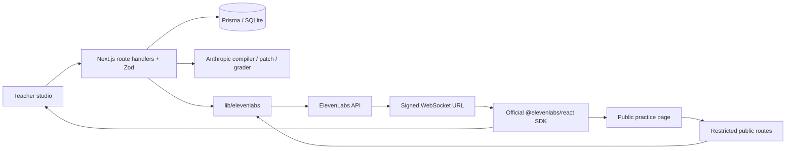

# Rehearsal

A local hackathon voice-agent studio: **write → test → refine → deploy → observe**. Next.js App Router, strict TypeScript, Tailwind, Prisma/SQLite, Zod, Anthropic and ElevenLabs. Violet, coral and amber, with a rehearsal-stage feel.

## Run

Node 22+ recommended.

```sh
npm install
cp .env.example .env.local
# Add keys to .env.local for live voice and AI compilation.
npx prisma generate
DATABASE_URL="file:./dev.db" npm run db:push
node --env-file=.env.local --import tsx prisma/seed.ts
npm run dev
```

Open http://localhost:3000. For the shorthand seed command, run `npm run seed`; it loads `.env.local` through Node. `npm test`, `npm run typecheck` and `npm run build` verify the app. With the offline dev server running, `npm run test:smoke` exercises the five-stage flow with disposable records and cleans them up. `npm start` serves the production build.

Without keys, the compiler uses explicitly disclosed local starter templates, seed creates local agents, a scripted text rehearsal is available, and one labeled graded demo fixture is included. No browser speech synthesis substitutes for ElevenLabs. Set both keys for the full live flow. To activate an existing offline agent after adding ElevenLabs, open Refine and save it; this creates its remote agent.

## Configuration

- `ELEVENLABS_API_KEY`: server only; needs agent, conversation, voice, TTS and Scribe permissions and available credits.
- `ANTHROPIC_API_KEY`: server only, required for actual prompt compilation, chat refinement and evidence-based grading.
- `ANTHROPIC_MODEL`: configurable model ID; default `claude-sonnet-4-6`. Availability depends on your account; select an available model if rejected.
- `DATABASE_URL`: default `file:./dev.db` (relative to Prisma schema). For Postgres, change Prisma provider to `postgresql`, supply URL, and migrate. JSON records are stored as strings for portability.
- `ADMIN_TOKEN`: **required in production**. Set an unguessable token and enter it via Owner settings in the sidebar. Never distribute the owner token to students. Development without a token is local-trust mode.
- `TWILIO_*`: reserved; telephony is a browser simulation, not connected.

Do not commit `.env.local` or the SQLite file. All provider calls execute in route handlers/server modules. The official browser SDK alone handles media using a server-issued signed URL. Run locally for the hackathon; public signed-link endpoints have no per-student quota, authentication or billing protection, so this is not hardened for internet-wide use.

## Architecture



## Integration map and assumptions

API documentation reviewed on 24 October 2026. REST wrappers centralize all server-side ElevenLabs calls in `lib/elevenlabs/index.ts`; React media transport is in `components/conversation.tsx`.

| Feature                 | API and implementation                                                                                                                    |
| ----------------------- | ----------------------------------------------------------------------------------------------------------------------------------------- |
| Agent lifecycle         | `POST /v1/convai/agents/create`, `PATCH/DELETE /v1/convai/agents/:id`; agent routes                                                       |
| Signed browser voice    | `GET /v1/convai/conversation/get-signed-url?agent_id=…`; official `@elevenlabs/react` `useConversation`, WebSocket transport              |
| Interruptions / silence | interruption client event, 7s turn timeout, normal eagerness, 30s silence end, 10min maximum call                                         |
| Low latency voice       | `eleven_flash_v2_5` agent model; observed callback timing shown in console, not network-isolated latency                                  |
| Expressive previews     | `POST /v1/text-to-speech/:voice_id`, `eleven_multilingual_v2`; picker previews use generated TTS                                          |
| Scribe                  | `POST /v1/speech-to-text` multipart `file`, `model_id=scribe_v2`; mic dictation and audio upload endpoint                                 |
| Voice library           | `GET /v2/voices` with search, gender, language and use_cases filters                                                                      |
| Voice Design            | `/v1/text-to-voice/design` previews then `/v1/text-to-voice` to save the chosen generated voice                                           |
| English / Hindi         | language selector, first language config, prompt asks to switch among configured languages; automatic language detection is not enabled   |
| Conversations           | GET details; verified agent association; import transcript, duration, summary, success evaluation and data collection; DELETE for privacy |
| Evaluation              | Provider goal criterion plus separate Claude role-play grading, with exact user-quote and turn-index verification                         |

The Anthropic model ID follows the [Claude model documentation](https://platform.claude.com/docs/en/about-claude/models/model-ids-and-versions).

Official references: [agent creation](https://elevenlabs.io/docs/api-reference/agents/create), [React SDK](https://elevenlabs.io/docs/eleven-agents/libraries/react), [authentication](https://elevenlabs.io/docs/eleven-agents/customization/authentication), [Scribe](https://elevenlabs.io/docs/api-reference/speech-to-text/convert), [voices](https://elevenlabs.io/docs/api-reference/voices/search), [TTS](https://elevenlabs.io/docs/api-reference/text-to-speech/convert), [Voice Design](https://elevenlabs.io/docs/api-reference/text-to-voice/design), [conversations](https://elevenlabs.io/docs/api-reference/conversations/get), [knowledge base](https://elevenlabs.io/docs/api-reference/knowledge-base/create-from-file), [Twilio](https://elevenlabs.io/docs/eleven-agents/phone-numbers/twilio-integration/native-integration), [testing](https://elevenlabs.io/docs/eleven-agents/customization/agent-testing).

The default voice ID must be accessible on the configured ElevenLabs account. Voice Design availability and model support depend on plan/account. Agent orchestration uses `gemini-2.5-flash` (override with `ELEVENLABS_LLM`) within ElevenLabs, while agent compilation uses Anthropic. Provider APIs can reject unavailable models; errors are surfaced rather than silently simulated. Secrets are not returned in public page JSON; prompt secrecy against adversarial conversation is not guaranteed by prompting alone.

## Session grading

The server imports the authoritative ElevenLabs transcript after conversation processing finishes. If it is still processing, save reports a retry message. The grader returns structured per-criterion scores, exact evidence and zero-based indices. Post-validation sets a criterion to missed/zero when its evidence is absent, points to an agent turn, or does not match the specified student turn; points are capped at the rubric maximum. The UI highlights verified evidence in green. The illustrative seed session is always labeled as a fixture.

## Implemented, simulated, deferred

Implemented: all five routes, local persistence, agent creation/update/delete, microphone conversations, dictation, voice picker/preview/design, compiler, patch preview/apply, form edits, version restore, published public link, iframe, dashboard, filters, session summaries/grading, transcript deletion, four seed characters, privacy notices and production owner-token gate.

Simulated: offline compiler templates, scripted text test with a fixed explicitly labeled reply, browser-only phone rehearsal, one seed transcript/grade. Offline grading awards no points and states that evaluation is unavailable. Chat edits require Anthropic rather than pretending to understand arbitrary requests.

Deferred: native Twilio inbound/outbound calls, synthetic caller stress testing, ElevenLabs native test execution, knowledge-base attachment, voice cloning/consent storage, external tools/calendar integration and real human transfer. No voice cloning is exposed. No server webhooks: conversation data is pulled after calls. No background polling or session auto-save. No live mood classifier or separate expressive role-play conversation model; emotional delivery is prompted, with expressive multilingual TTS for picker previews. No first-message or tool latency instrumentation beyond browser message timing. Account-based multi-tenancy, quotas, robust cross-provider transaction recovery and production-grade auth are out of scope.

Remote/local updates are sequenced remote first, then database; a database failure after a successful remote mutation may require manual reconciliation. Deleting an agent deletes its local sessions but does not individually purge historical provider conversations; delete those sessions first when provider transcript erasure is needed.

See [verification details](docs/VERIFICATION.md) and [the demo script](docs/DEMO_SCRIPT.md) for a three-minute walkthrough. Milestone commits record the build; live API/microphone checks require your credentials and browser permission.
